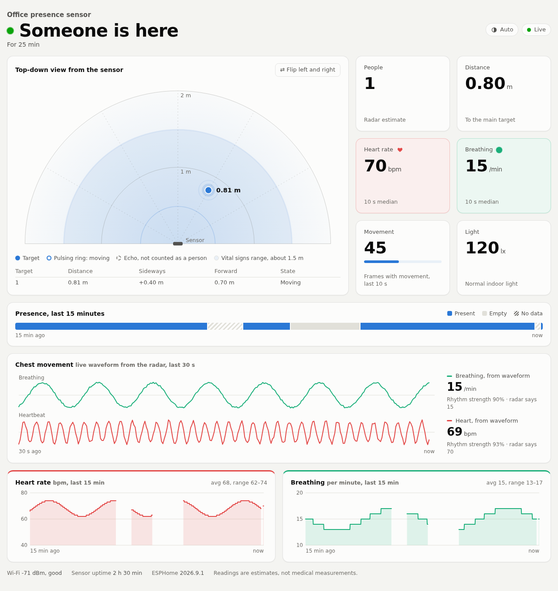
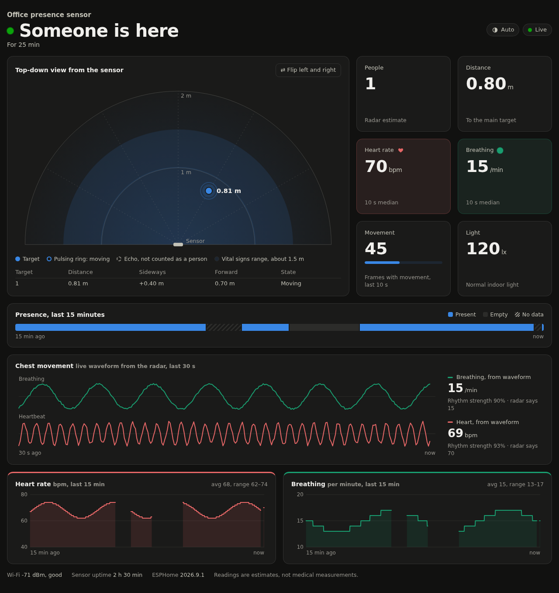
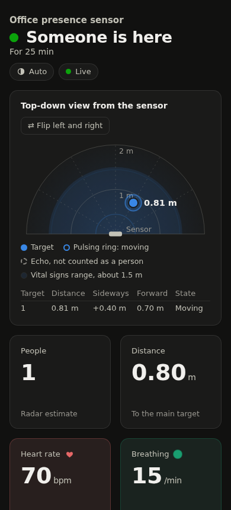
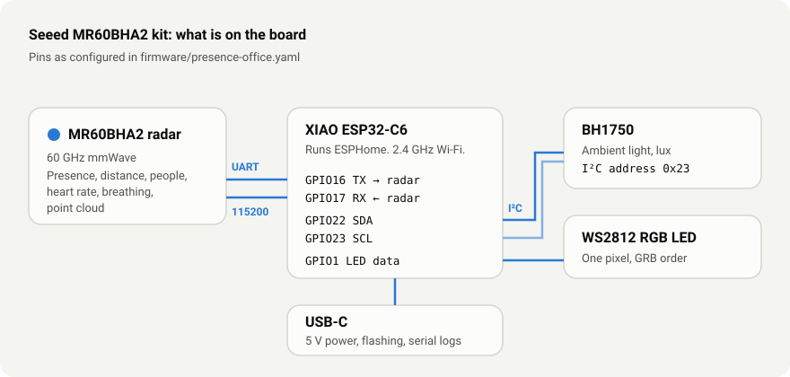
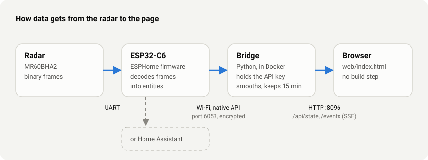

# Presence lab

A live web page for the **Seeed Studio MR60BHA2 mmWave kit** (60 GHz radar on a XIAO ESP32-C6). It shows
whether someone is in the room, where they are, how many people the radar sees, and their heart rate and
breathing rate. The page reads the sensor directly over the ESPHome native API, with no Home Assistant
needed.



<sub>Screenshots use demo data, so the page can be shown without a person in front of the sensor.</sub>

| Dark theme | Phone |
|---|---|
|  |  |

## What the page shows

- **Headline:** "Someone is here" or "Nobody here", and for how long.
- **Top-down map:** each radar target as a dot at its real position, with the 1 m and 2 m rings and the
  1.5 m zone where vital signs work. A pulsing ring means the target is moving. Dashed circles are echoes
  the radar does not count as people. A button flips left and right to match how the sensor is mounted.
- **Tiles:** people count, distance, heart rate (red), breathing rate (green), movement and room light.
  Heart rate and breathing are 10 s medians, because single radar frames can jump.
- **Presence timeline:** present, empty and no-data stretches over the last 15 minutes.
- **Chest movement:** the radar's own breathing and heartbeat waveforms, live, over the last 30 s, with
  rates worked out from them independently of the radar's numbers (see below).
- **Charts:** heart rate and breathing over the last 15 minutes, with average and range.
- **Theme button:** automatic (follows your system), light or dark. The choice is remembered.

Heart rate and breathing only appear when a person sits still within about 1.5 m of the sensor, facing it.
These are estimates from a hobby radar, not medical measurements.

## Hardware

**Kit used:** Seeed Studio XIAO 60GHz mmWave Human Breathing Heartbeat Sensor (MR60BHA2), bought from
[OpenELAB](https://openelab.de/products/seeed-studio-xiao-60ghz-1). It is the MR60BHA2 radar board with a
XIAO ESP32-C6 plugged in, in a 3D-printed case, and arrives with ESPHome already installed. No soldering or
wiring is needed: plug in a USB-C cable and flash it. Product details and photos are on the
[Seeed wiki](https://wiki.seeedstudio.com/getting_started_with_mr60bha2_mmwave_kit/).

Seeed gives about 1.5 m for breathing and heart rate and about 6 m for detecting a still person.



| Part | What it does | Connection |
|---|---|---|
| MR60BHA2 | 60 GHz mmWave radar: presence, distance, target count, heart rate, breathing, point cloud | UART at 115200 baud, ESP TX on GPIO16, RX on GPIO17 |
| XIAO ESP32-C6 | Runs the ESPHome firmware and talks Wi-Fi (2.4 GHz only) | |
| BH1750 | Ambient light in lux | I²C on GPIO22 (SDA) and GPIO23 (SCL), address 0x23 |
| WS2812 | One RGB LED | GPIO1 |
| USB-C | Power, flashing and serial logs | |

**Placement:** point the front of the radar at where people sit, at chest height if you want vital
signs, and keep it within 1.5 m of the chair. Presence and position work further out. Metal and moving
things (fans, curtains) in front of the radar cause false targets.

## How it fits together



1. The radar sends binary frames over UART.
2. The ESP32 runs ESPHome, decodes the frames and publishes entities over the encrypted native API
   (port 6053).
3. The **bridge** (`bridge/server.py`) connects to that API, keeps the last 15 minutes in memory and
   serves the page. The API key stays on the bridge; the browser only gets decoded values.
4. The **page** (`web/index.html`) is one self-contained HTML file with no build step and no external
   libraries. It loads `/api/state` once, then updates live from `/events` (Server-Sent Events).

## Firmware

Two ESPHome configs are in `firmware/`:

- `presence-office.original.yaml` is a cleaned-up version of Seeed's ESPHome example. It works with Home
  Assistant on its own and with this page, minus the map.
- `presence-office.yaml` is the same plus two text sensors the page needs: `radar_points` (the point
  cloud, about 10 times a second, for the map and target table) and `radar_phases` (the chest-movement
  waveform, for the "Chest movement" card).

Both use a local copy of ESPHome's `seeed_mr60bha2` component (`firmware/components/seeed_mr60bha2`),
with these additions:

- **Point-cloud decoding.** Frame type `0x0A04` carries, per target: x and y in metres (float), a
  Doppler index (int32) and a cluster index (int32). The stock component ignores this frame.
- **Waveform decoding.** Frame type `0x0A13` carries three floats: total, breathing and heart phase,
  which is the chest movement the radar computes its rates from. It arrives about 10 times a second. The
  ESPHome native API keeps only the newest value of an entity when it is busy, which lost about 1 in 6
  samples, so each update repeats the last 12 samples with a running sequence number and the bridge
  drops duplicates. With that, a 60 s test had no gaps.
- **Movement tracking.** A non-zero Doppler index means something is moving, even a seated person
  breathing. Furniture reads 0. Exposed as a "Movement" sensor (frames with movement per 10 s).
- **Steadier presence for Home Assistant.** The radar's own presence flag can stay on for hours on a
  static object. The config only reports presence when the flag is on *and* there was a distance or
  vital-sign reading or movement in the last 5 minutes.
- **No stale values.** Heart rate, breathing and distance turn "unknown" after 60 s without updates
  and when presence clears, instead of showing an old number for hours. Zeros from the radar become
  gaps, not drops to zero.

Frame layout follows Seeed's
[Arduino library](https://github.com/Seeed-Projects/Seeed-mmWave-library). Other radar frames used: `0x0F09` presence, `0x0A14` breathing rate, `0x0A15` heart rate, `0x0A16`
distance.

### Flashing

```bash
python3 -m venv .venv-esphome && .venv-esphome/bin/pip install esphome
cd firmware
mkdir -p common && cp common.example.yaml common/common.yaml
cp secrets.example.yaml secrets.yaml   # then fill in Wi-Fi, API key and OTA password
../.venv-esphome/bin/esphome run presence-office.yaml
```

The first flash goes over USB. After that, `esphome upload presence-office.yaml --device <ip>`
works over Wi-Fi. Tested with ESPHome 2026.9.1.

## Software (the bridge and page)

Requirements: Docker, and the sensor reachable on your network.

```bash
cp .env.example .env   # set ESPHOME_HOST and ESPHOME_KEY (the API key from secrets.yaml)
docker compose up -d --build
```

Then open `http://<docker-host>:8096/`. The container restarts on its own after a reboot.

What the bridge does besides passing values through:

- **Holds presence through dropouts.** With a person sitting 0.5 m away, the radar's presence flag
  still dropped out for a fraction of a second, every few seconds. The page only switches to "Nobody
  here" after 15 s of continuous empty, so leaving the room shows up to 15 s late. Change
  `EMPTY_HOLD_SECS` in `bridge/server.py` to tune it.
- **Reconnects** if the sensor goes quiet for 30 s or restarts.
- **Sends a heartbeat** every 3 s, so the page can tell "sensor offline" from "page lost connection".

**Rates from the waveform (experimental).** The page takes the last 30 s of each waveform and finds its
strongest rhythm in the normal range (6–36 breaths/min, 45–150 bpm). It shows a number only when that
rhythm clearly dominates and two estimates 2 s apart agree; otherwise it says why not. "Rhythm strength" is the share of the signal in that rhythm. The radar's own
number is shown next to it for comparison. It gives the right answer on synthetic test signals. With a
real person it rarely shows a number, because neither waveform has one clear rhythm (see Known limits).

`probe.py` is a small command-line tool that connects with the same `.env` and prints every entity and
a stream of values, which helps when checking a new firmware.

## Using it with Home Assistant

The ESPHome native API accepts more than one client, so the page and Home Assistant can both connect
to the original firmware. For experiments with the lab firmware, I disabled the device in Home
Assistant (Settings → Devices & services → ESPHome → the device → Disable) so the two weren't fighting
over updates. To go back: flash `presence-office.original.yaml` (or keep the lab one, Home Assistant
gains "Radar Points" and "Radar Phases" entities) and re-enable the device. Those two update about 10 times
a second, so if you keep the lab firmware, exclude them from Home Assistant's recorder:

```yaml
recorder:
  exclude:
    entities:
      - sensor.presence_office_radar_points
      - sensor.presence_office_radar_phases
```

Check the exact entity IDs in Home Assistant; they depend on the device name.

## Known limits

- Left and right on the map are not calibrated against a real room. Use the flip button if the dot
  moves the wrong way.
- Two-person tracking has only been tested with demo data, not two real people.
- The cause of the presence dropouts is unknown. They may come from the radar or from the lab firmware;
  there was too little comparable data from the original firmware to tell.
- Two minutes with a person sitting still at about 0.9 m: for the first 50 s, the heartbeat waveform's
  strongest rhythm (77–81 bpm) was within about 4 bpm of the radar (75–78), then it wandered to 56 and
  124 bpm. Its rhythm strength, as the page measures it, stayed at 9–18%. The breathing waveform looks
  smooth, but has no single dominant rhythm either: its strongest frequency (5–10/min) was likely slow
  drift. Counting its upward swings gave 12.4/min, while the radar's median was 18. Neither was checked
  against counted breaths or a pulse.
- The radar's distance jumped by 20–40 cm during that still test, so it can't tell you whether someone
  is keeping still.
- History lives in memory, so restarting the container clears the charts.
- The page has no login and shows vital signs. Keep it on your local network.

## License

MIT, see [LICENSE](LICENSE). The exception is `firmware/components/seeed_mr60bha2/`, a modified copy of
an ESPHome component that keeps ESPHome's licenses (GPL-3.0 for the C++ files, MIT for the Python
files). See its [NOTICE.md](firmware/components/seeed_mr60bha2/NOTICE.md).

Seeed's ESPHome example
([limengdu/MR60BHA2_ESPHome_external_components](https://github.com/limengdu/MR60BHA2_ESPHome_external_components))
was the starting point for the firmware config.
